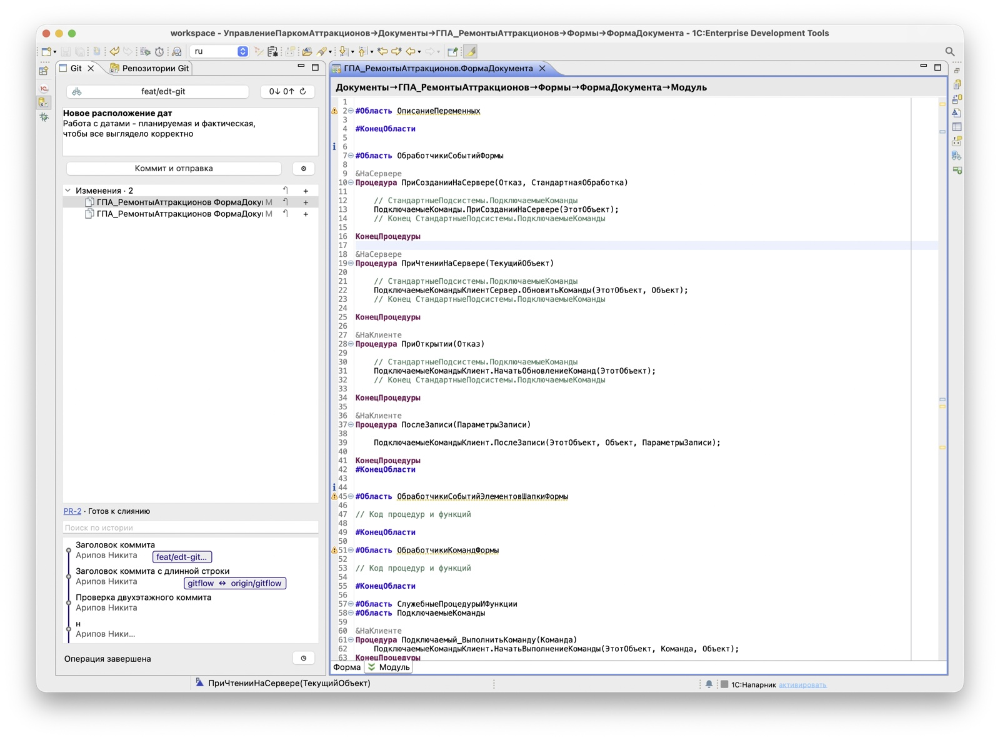
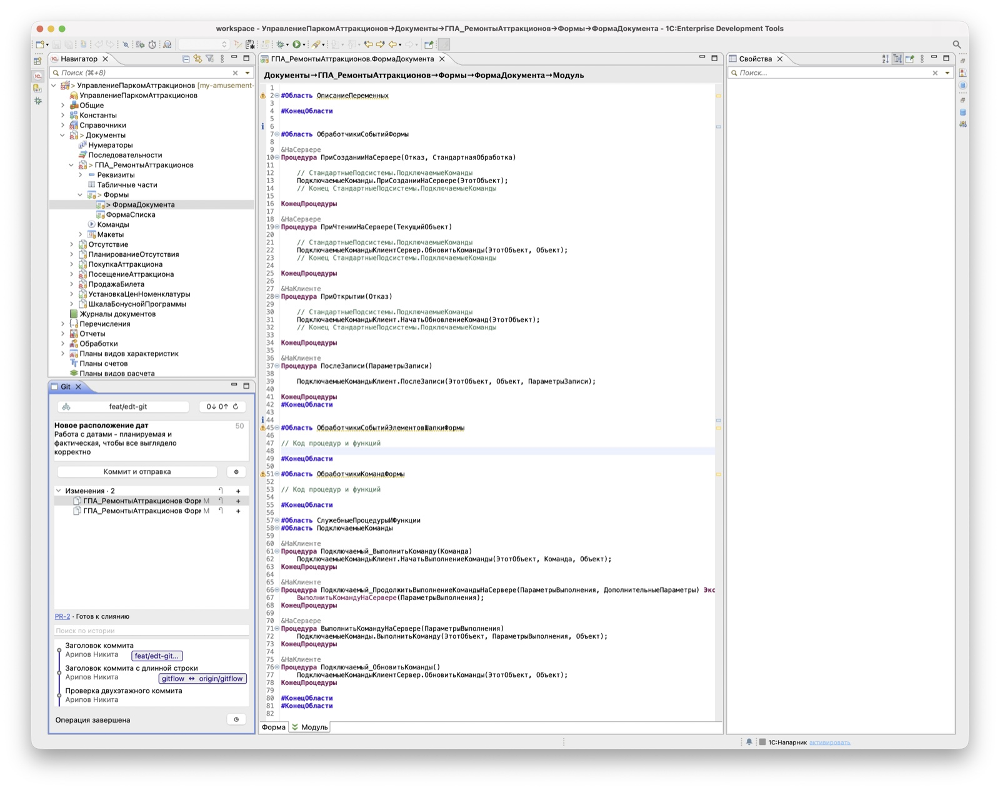

# Git Flow для 1C:EDT

Git Flow — панель для работы с Git в 1C:EDT. В ней можно подготовить файлы к
коммиту, написать сообщение, переключить ветку, получить или отправить изменения
и найти нужный коммит в истории. Основные операции доступны из одной панели.

[**Установить плагин**](https://oxotka.github.io/git-flow-edt/) · [Видеообзор](https://youtu.be/GiZ9AKqpAUU) · [Telegram автора](https://t.me/AriN1C) · [Сообщить об ошибке](https://github.com/Oxotka/git-flow-edt/issues/new?template=bug_report.yml)

| Git Flow рядом с редактором | Git Flow под навигатором |
| --- | --- |
| [](docs/images/git-flow-edt.jpg) | [](docs/images/git-flow-edt-under-navigator.jpg) |

**В версии 0.20.1** в окнах переключения и слияния появился отбор веток.
Слитые локальные ветки и ветки с исчезнувшей веткой отслеживания можно
выделить и удалить из контекстного меню.
[Изменения 0.20.1](CHANGELOG.md#0201--24-ноября-2026)

## Установка в EDT

Добавьте в EDT сайт установки и обновления:

```text
https://oxotka.github.io/git-flow-edt/
```

1. Откройте **Справка → Установить новое ПО… → Добавить…**.
2. Укажите имя **Git Flow** и вставьте ссылку в поле адреса.
3. Выберите компонент **Git Flow**, завершите установку и перезапустите EDT.
4. Откройте перспективу **Git** или панель через **Окно → Показать представление → Другие… → Git Flow → Git**.

Для обновления откройте **Справка → Проверить обновления**.
Если плагин уже установлен из ZIP, добавьте ссылку в доступные сайты ПО
в настройках EDT, затем проверьте обновления.

Для установки из файла скачайте ZIP из [последнего релиза](https://github.com/Oxotka/git-flow-edt/releases/latest)
и выберите **Добавить… → Архив…** в окне установки. Архив одинаков для Windows
и macOS; распаковывать его не нужно.

## Совместимость

Git Flow проверен в **1C:EDT 2026.1.3 на Windows и macOS**.
Ранее также проверен в **1C:EDT 2025.2.6 на Windows**.

В 0.17.2 возвращено переключение через JGit без дополнительного согласования
со снимками EDT, добавленного в 0.17.1. По результатам пользовательской проверки
согласование замедляло переключение и не устраняло повторное отображение изменений.
Сохранение локальных изменений и обновление проектов после checkout остаются.
Подробности: [диагностика переключения](docs/checkout-snapshot-coordination.md).

В 0.17.4 обновление проекта после переключения стало точечным: checkout возвращает
пути изменившихся файлов, и EDT обновляет только их каталоги вместо полного обхода
проекта. Полный обход остается запасным вариантом, если список путей пуст или
в нем слишком много каталогов. Порядок работы с ветками и приложениями описан
в [разборе приложений](docs/checkout-applications-analysis.md).

## Первый коммит

Откройте в EDT проект, подключенный к Git-репозиторию, и внесите изменения.
Панель **Git** доступна в перспективе **Git** или через
**Окно → Показать представление → Другие… → Git Flow → Git**.

Если репозиториев несколько, выберите нужный вверху панели.

1. Нажмите `+` рядом с файлами, которые хотите включить в коммит.
   Они появятся в разделе **Подготовлено**. Кнопка `−` убирает файл из коммита,
   сохраняя правки.
2. Напишите сообщение коммита в поле над списком файлов.
3. Нажмите **Коммит и отправка**. Чтобы создать только локальный коммит,
   отключите отправку в настройках кнопкой с шестеренкой — основная кнопка
   будет называться **Коммит**.

По умолчанию коммит включает только подготовленные изменения. В шестеренке
можно включить **Автоматическая подготовка изменений**:
при пустом разделе **Подготовлено** будут включены все файлы из списка
**Изменения**, в том числе новые и удаленные. Если есть подготовленные
изменения, коммит включает только их. При включенной автоматической подготовке пустой
раздел **Подготовлено** скрыт и появляется после подготовки файлов.

Когда изменений нет и у локальной ветки еще нет связи с удаленной, кнопка
**Опубликовать ветку** отправляет существующие коммиты в `origin` и настраивает
связь с одноименной веткой. Сообщение коммита не требуется.

Название ветки вверху панели открывает выбор веток. Круговая стрелка рядом
со счетчиками входящих и исходящих коммитов запускает синхронизацию:
проверку сервера, получение или отправку изменений в зависимости от состояния ветки.

В окне переключения веток доступны три режима. Окно запоминает последний
выбранный режим. Он также используется в окне слияния. Избранные ветки видны
при любом отборе.

- **Актуальные** — скрывает закрытые и слитые ветки,
  сохраняя текущую ветку в списке.
- **Все** — показывает все локальные ветки с отметками о слиянии и исчезнувшей
  ветке отслеживания.
- **Закрытые и слитые** — показывает ветки с исчезнувшей веткой отслеживания
  и ветки, чьи коммиты вошли в историю цели слияния. По умолчанию проверяются
  основная ветка `origin` и существующие `main`, `master` и `develop`.
  Другую локальную или удаленную ветку можно выбрать через шестеренку
  **Настройки → Цель слияния…**.
  Чтобы удалить несколько локальных веток, выделите их в списке и выберите
  **Удалить локальные ветки** в контекстном меню.
  Ветки на сервере сохраняются. Для веток с исчезнувшей веткой отслеживания
  Git также учитывает слияние в текущую ветку.

Статус исчезнувшей ветки отслеживания рассчитывается по локальным ссылкам Git.
Если ветку только что удалили на сервере, обновите ссылки с очисткой
(`git fetch --prune`) и заново откройте окно переключения.

## Настройка хостинга

Состояние запроса и его создание работают для **GitLab**, включая Self-Managed,
и для **GitHub**: github.com и GitHub Enterprise Server. Подключение настраивается
в шестеренке панели пунктом **GitHub…** или **GitLab…** — одна форма для обоих хостингов.

1. Откройте шестеренку панели и выберите **GitHub…** для GitHub или **GitLab…** для остальных серверов.
2. Проверьте **Адрес сервера**: по умолчанию это адрес сервера из
   `remote.origin.url`.
3. Выберите **Тип сервера** — **GitLab** или **GitHub**. Для адресов со словами
   `gitlab` или `github` тип определяется автоматически; для GitHub Enterprise
   с другим доменом выберите его вручную, выбор запомнится для хоста.
4. Под полем **Токен** нажмите **Создать токен на GitHub** или **Создать токен на GitLab**.
   Откроется форма с именем EDT Git Flow, описанием и правами для выбранного сервера. На GitHub
   выберите репозитории в **Repository access**. Срок действия по ссылке — 360 дней. Для GitLab введите дату из подсказки в поле **Expiration date**. Создайте токен и вставьте его в EDT.
5. Настройте **Сертификат**: на Windows плагин доверяет системному хранилищу,
   поэтому выбор сертификата скрыт; на macOS и Linux по умолчанию используется
   стандартное хранилище JVM. Для сервера с сертификатом внутреннего центра
   сертификации на этих платформах можно выбрать файл сертификата.
6. Нажмите **Проверить подключение**, затем **Сохранить**.

Чтобы отключить MR/PR для сервера, нажмите **×** рядом с токеном и **Сохранить**. Строка над историей исчезнет. После сохранения нового токена панель сразу проверит текущую ветку.

Проверка использует выбранный в форме сертификат до сохранения настроек.

Поле **Ветки для MR** (для GitHub — **Ветки для PR**) задает префиксы веток
через запятую, для которых предлагается запрос: по умолчанию `fix/` и `feat/`.
Префикс проверяется с начала имени: для ветки `feat/edt-git` подходит `feat/`,
но не `git`. Пустое поле или `*` включает все ветки, в том числе основную. После сохранения настроек карточка обновляется без смены ветки.

Права токена:

- **GitLab** — личный токен со scope `api`.
- **GitHub** — в **Resource owner** выберите владельца репозитория.
  В **Repository access** нажмите **Only select repositories**, затем выберите проект в **Selected repositories**.
  В **Permissions** проверьте подставленные разрешения для репозитория:
  **Pull requests → Read and write** и **Contents → Read-only**.
  Нажмите **Generate token** и вставьте выданный токен в EDT.
  Если вместо этих полей виден список scopes, открыта страница **Tokens (classic)**:
  перейдите в **Fine-grained tokens** или воспользуйтесь ссылкой из EDT.
  Для статусов внешнего CI можно добавить **Commit statuses → Read-only**,
  для правила одобрений — **Administration → Read-only**.
  Недоступные через API проверки и правила не показываются в карточке.

Токен хранится в шифрованном хранилище EDT и отправляется только на сервер
из настроек. Если remote репозитория указывает на другой хост, строка запроса
не появляется и запросы не уходят. Адрес, тип сервера и токен запоминаются
отдельно для каждого хоста: в одной рабочей области можно работать
и с корпоративным GitLab, и с GitHub. Настройка сертификата общая для всей
рабочей области: выбранный файл заменяет набор доверенных сертификатов, а не
дополняет его. GitHub обращается через системный прокси, GitLab — напрямую.
Проверка подключения сообщает, что именно настроено не так.
Для GitHub успешное подключение не подтверждает право токена создавать PR:
оно проверяется сервером при отправке запроса. Права пользователя на push
не заменяют разрешение токена `Pull requests: read and write`.

Ограничения первой итерации:

- незакрытые обсуждения pull request не показываются: REST API GitHub их
  не отдает;
- одобрение, комментарии, ревью, повторное открытие и слияние запроса
  выполняются в браузере: из EDT запрос только показывается и создается;
- pull request из fork-веток и чужих репозиториев не поддерживается;
- закрытый PR показывается как «Закрыт» и повторно из панели не создается;
- удаление ветки после слияния настраивается только для GitLab: в GitHub это
  настройка репозитория, поэтому пункт скрыт.

## Видеообзор

[](https://youtu.be/GiZ9AKqpAUU)

[Смотреть на YouTube](https://youtu.be/GiZ9AKqpAUU).

## Возможности

- **Работать с файлами.** Панель показывает измененные и подготовленные файлы.
  Кнопки `+` и `−` добавляют файл в будущий коммит или убирают его оттуда.
  Через контекстное меню можно открыть файл, сравнить изменения и посмотреть
  историю. Файлы репозитория вне проектов EDT тоже можно открыть и сравнить,
  включая конфликты. Отмену правок плагин выполняет после подтверждения.
- **Создавать коммиты.** Сообщение можно написать в несколько строк и отправить
  коммит сочетанием `Ctrl+Enter`. В настройках можно включить оформление первой
  строки как заголовка: она выделится полужирным. Счетчик покажет, сколько
  символов из 72 осталось. При превышении он станет красным и покажет превышение
  отрицательным числом. Подсказка о заголовке и описании показывается при той же
  настройке. Между заголовком и описанием плагин добавит пустую строку при
  создании коммита. Если оформление выключено, поле остается
  обычным многострочным вводом. Отправка на сервер после коммита включена по
  умолчанию; ее можно отключить кнопкой с шестеренкой. Сообщение синхронизируется
  с полем в штатном **Индексировании Git**, если обе панели показывают один
  репозиторий. После создания коммита оба поля очищаются.
- **Предлагать сообщение коммита.** Если установлен Workmate, в контекстном
  меню поля сообщения доступна команда **Предложить сообщение коммита
  (1С:Напарник)**. Напарник составляет вариант по подготовленным изменениям;
  при включенной автоматической подготовке и пустом индексе учитывает все
  изменения из списка, не меняя подготовку файлов. Текущий текст сообщения
  передается как контекст.
- **Синхронизировать ветку.** Плагин проверяет изменения на сервере перед
  отправкой. Если ветка уже изменилась, он пытается сначала получить новые
  коммиты. При конфликте помогает перейти к штатному слиянию в EDT. После
  такого слияния отправку нужно запустить отдельно. Принудительную отправку
  (`force push`) плагин не делает.
- **Выбирать и настраивать ветки.** Ветки и теги показаны деревом. Их можно
  искать и добавлять в избранное. В списке видны автор, сообщение последнего
  коммита и время его создания. Список можно сортировать по активности или имени,
  в прямом и обратном порядке. В меню ⚙ настраивается иерархия веток. Это общая
  настройка EDT: при первом запуске Git Flow включает ее, а последующие изменения
  действуют во всех представлениях EDT. То же дерево веток доступно в штатном
  окне слияния EDT. При переключении ветки плагин временно сохраняет подготовленные,
  измененные и новые файлы, а затем возвращает их.
- **Управлять ветками из контекстного меню.** Локальную ветку можно переключить,
  переименовать или удалить. Если в ней есть неслитые коммиты, перед удалением
  появится подтверждение. Для текущей ветки доступны получение и отправка
  изменений. У удаленной ветки можно создать локальную копию или переименовать
  ее. При переименовании удаленной ветки связанная локальная ветка получает то же
  имя. Если у локальной ветки настроена связь с удаленной, Git Flow сначала
  предлагает переименовать обе и меняет локальную только после успешного
  переименования удаленной.
- **Временно убирать изменения.** Быстрый стеш сохраняет текущие правки, а
  команда возврата восстанавливает последний стеш. При создании ветки через
  мастер EDT плагин временно сохраняет локальные изменения и возвращает их
  после закрытия мастера.
- **Показывать историю.** Под списком файлов видны коммиты текущей ветки с
  графом, автором и сообщениями. Для коммита доступны сравнение, копирование
  хеша и другие действия через контекстное меню. Поиск находит совпадения по
  сообщению, автору или началу хеша во всей истории текущей ветки; нажмите
  `F3`, чтобы перейти к следующему совпадению. На текущем коммите (HEAD)
  доступна **Слить…** — штатная команда из **Групповой разработки** EDT.
- **Видеть и создавать запрос на слияние.** Под списком изменений, над поиском по истории,
  показывается merge request GitLab (`MR-123`) или pull request GitHub
  (`PR-123`): черновик, одобрения, проверки, конфликты, готовность к слиянию,
  а у слитого запроса — кто и когда его слил. Ссылка **Создать MR** или
  **Создать PR** открывает диалог: заголовок берется из последнего коммита,
  целевая ветка по умолчанию — ветка по умолчанию репозитория, можно создать
  черновик и выбрать проверяющего. Последние проверяющие запоминаются отдельно
  для каждого сервера и проекта. Во время создания повторная отправка из диалога
  заблокирована. Запрос предлагается только для веток
  с настроенными префиксами, по умолчанию `fix/` и `feat/`. В контекстном меню
  текущего коммита HEAD доступна та же команда **Создать MR…** или **Создать PR…**,
  если запроса для текущей ветки еще нет или предыдущий закрыт без слияния. В последнем случае в конце строки также появляется ссылка **Создать новый MR** или **Создать новый PR**. После создания страница MR или PR автоматически открывается в браузере.
  Повторно открыть ее можно по номеру запроса в панели. Состояние обновляется при смене репозитория или
  ветки (в том числе при открытии панели), по кнопке синхронизации и после
  создания запроса. Подключение настраивается в разделе
  [Настройка хостинга](#настройка-хостинга).

В штатном окне **Индексирование Git** кнопка **Фиксировать + Push** (или
**Отправить**, когда коммитить нечего) использует проверку удаленной ветки от
Git Flow.

## Для разработчиков

<details>
<summary>Сборка из исходников</summary>

Нужны JDK 17–21, Maven 3.9+ и EDT 2026.1.3, указанная в
[`releng/edt-2026-1.target`](releng/edt-2026-1.target). Локальная ЕДТ нужна
только для компиляции и не упаковывается в архив.

В target-файле указан локальный путь к установленной EDT на macOS. Перед
сборкой замените его на каталог `plugins` своей установки EDT.

```bash
./.tools/bin/mvn verify
```

Проверка запускает весь набор core-тестов и тесты логики UI без открытия окон,
включая отображение этапов операций, расчет процентов и передачу отмены.
Автоматическая подготовка перед коммитом обрабатывает всю видимую выборку
без дробления на пачки. Отмена до начала оставляет индекс прежним; при отмене
во время подготовки выборка завершается, а создание коммита не продолжается.
Состав и порядок списков подготовленных и неподготовленных файлов проверяются
на временных Git-репозиториях через статус JGit и кеш EGit, в том числе при конфликте.
Соответствия типов метаданных 1С и иконок, а также наличие текстовых подписей
на русском и английском языках проверяются отдельно от SWT.
Для истории проверяются подписи веток и тегов, detached HEAD, порядок после
слияния и границы страниц обоих способов чтения. Поисковая сессия проверяется
на смену репозитория, ветки и HEAD, повторный поиск, отмену и ошибки фоновой задачи.
Преобразование путей объектов, модулей и форм в подписи проверяется без SWT
на русском и английском языках, с доступными и отсутствующими иконками.
Загрузка страниц проверяется на порядок коммитов, отбрасывание устаревших
результатов и переход к найденному коммиту после догрузки контекста.
Для иконок проверяется кеширование найденных и отсутствующих ресурсов; кеш
сбрасывается при закрытии представления.
Тестовый модуль не входит в установочный p2 ZIP.

Синтетическое сравнение массовой подготовки файлов запускается отдельно:

```bash
./.tools/bin/mvn verify -Dtest=WorkingChangesBenchmark
```

Бенчмарк создает временные репозитории с 800, 1000 и 5000 измененных файлов,
проверяет состав индекса, сохранение частично подготовленного файла и отмену.
Он не входит в обычный прогон тестов; результаты и ограничения описаны
в [исходном отчете](docs/benchmarks/2026-10-15-staging.md) и
[проверке подготовки всей выборки](docs/benchmarks/2026-10-15-staging-whole-selection.md).
Поведение интерфейса в EDT проверяется отдельно вручную.

Для карточки MR/PR проверяются отбрасывание устаревшего ответа при смене ветки
или репозитория, скрытие панели и повторное обновление без SWT. Тесты GitHub
учитывают одновременно check-runs и commit statuses внешнего CI, отсутствие
права на Checks API и отзыв одобрения на следующей странице ревью.
На macOS проверено использование стандартного доверия JVM без файла сертификата.
На локальном HTTPS-сервере проверено доверие выбранному, но еще не сохраненному
сертификату для GitLab и GitHub, а также ошибка недоступного файла сертификата.
Для кеша проверяющих проверяются изоляция серверов и отказ от старых записей
без хоста. Список последних проверяющих из прежней версии заполняется заново.
Проверка GitHub не выводит права токена из прав учетной записи на репозиторий;
причина отказа создания PR сохраняется в `~/gitflow-hosting.log`.
Эти проверки не подтверждают ручную проверку интерфейса и создания PR в EDT.

После успешной сборки ZIP-репозиторий обновления находится в
`dev.edt.gitflow.repository/target/`. Этот архив можно выбрать в мастере
установки EDT. Для запуска второго экземпляра EDT с плагином из исходников
используйте конфигурацию PDE с продуктом
`com._1c.g5.v8.dt.product.application.rcp`.

</details>

## Обратная связь

Нашли ошибку или хотите предложить улучшение? Создайте [issue](https://github.com/Oxotka/git-flow-edt/issues).
Для ошибки укажите версии EDT и плагина, операционную систему и шаги воспроизведения.

## Лицензия

[MIT](LICENSE). Copyright © 2026 Никита Арипов.

### Публикация сайта обновления

GitHub Actions публикует сайт на GitHub Pages после выхода стабильного релиза.
Workflow берет p2 ZIP из последнего опубликованного релиза и размещает его
содержимое по постоянному адресу. Плагин повторно не собирается.
При изменении страницы сайта выполняется публикация с тем же последним релизом;
ее также можно запустить вручную через **Actions → Publish EDT update site**.
